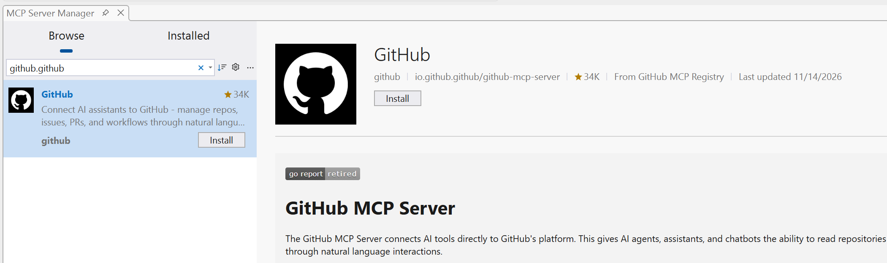
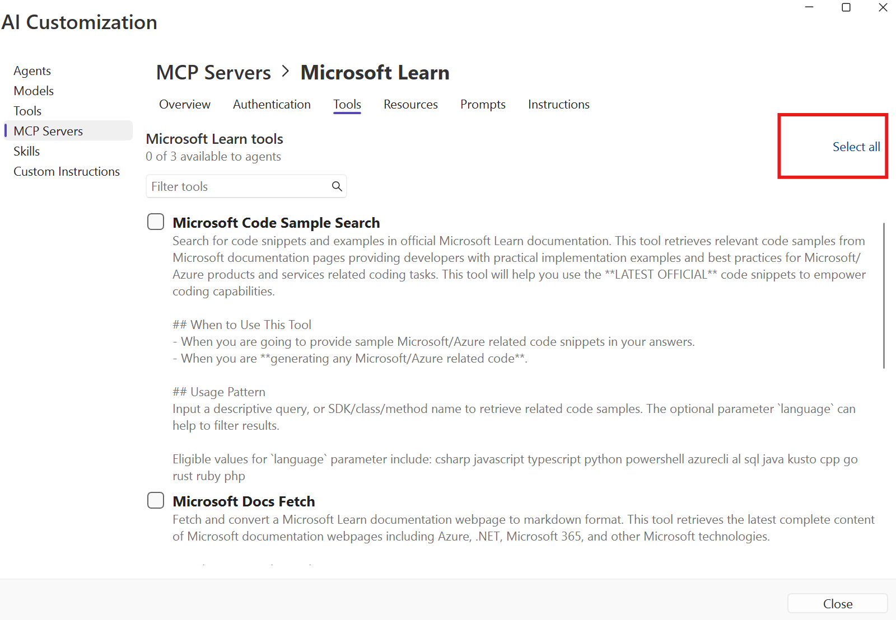
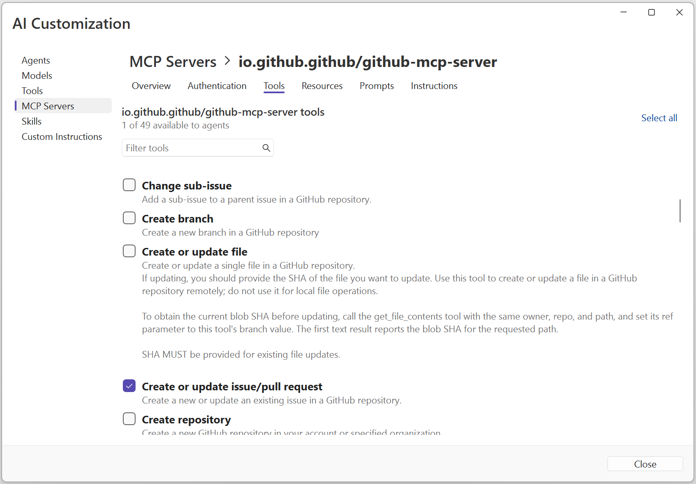

Model Context Protocol (MCP) is an open protocol that standardizes how applications provide context to large language models (LLMs). MCP servers extend GitHub Copilot's capabilities by connecting to external tools and services, giving it access to real-time data and the ability to perform actions.

In this part, you'll learn how to add MCP servers to Visual Studio and use them to get information about optimizing your application.

## Adding MCP Servers from the Gallery

Visual Studio provides a gallery of pre-configured MCP servers that you can easily add to your project.

To install the GitHub MCP server:
1. [ ] In Visual Studio, select **Extensions > MCP Registries...** to open the **MCP Server Manager**.

   

1. [ ] Select the **Browse** tab and search for `github.github`.
1. [ ] Select the **GitHub** server published by **github**, then click **Install**.

   

1. [ ] When prompted, trust and install the remote server.

   

To see your installed tools and authenticate the GitHub MCP server:
1. [ ] Open the Copilot Chat window by clicking on the GitHub Copilot icon and selecting **Open Chat Window** or press `Ctrl+\+C`.
1. [ ] Click on the **Tools** icon at the bottom of the chat window to see built-in tools and tools from installed MCP servers.

   

1. The GitHub MCP requires authentication. From the **Tools** menu in the chat, expand **the Added GitHub MCP** with the ... and then select **Edit**:

   

You will see a **Authentication required** message. Click on it and click Authenticate. Afer this you will see that it is online and ready to use.

   

> [!TIP]
> MCP servers can provide access to documentation, APIs, and other services that can help Copilot give you more accurate and contextual responses.

## Using MCP Servers to Get Information

Now that you have the Microsoft Learn and GitHub MCP servers installed, let's use them to get information about optimizing asset loading in the application.

1. [ ] In Copilot Chat, switch to **Agent** mode.
1. [ ] Open **AI Customization**, select **MCP Servers > Microsoft Learn**, and open the **Tools** tab.
1. [ ] Click **Select all** to make all Microsoft Learn tools available to agents.

   

1. [ ] Click **Close** to return to Copilot Chat.
1. [ ] Type the following prompt: `Using the Microsoft Learn docs mcp, what are the best practices for optimizing image loading and asset delivery in a Blazor Server application?`
1. Copilot will ask for permission for each request. You can approve each manually or **Allow in this session**
1. 
1. [ ] Review the response from Copilot, which now has access to the latest Microsoft documentation through the MCP server.

## Creating GitHub Issues with MCP

The GitHub MCP server allows Copilot to interact with your GitHub repository. Let's use it to create issues for improvements we want to make to the application.

> [!NOTE]
> This exercise requires write access to the repository. Fork `workshop-tinyshop` before continuing. If you are using a direct clone because your account cannot fork, skip issue creation and ask Copilot to draft the issues instead.

1. [ ] Ensure that the GitHub MCP server is selected as an active tool in Copilot Chat and that the tools are enabled for .
1. [ ] In the same chat session, type: `Based on the asset optimization recommendations, create 3 GitHub issues for improving the TinyShop application's performance.`

   > NOTE:
   > Copilot will use the GitHub MCP server to create the issues directly in your repository. You may be prompted to authorize the action.

1. 
1. [ ] Review the issues that Copilot proposes to create.
1. [ ] Approve the creation of the issues when prompted.
1. [ ] Navigate to your GitHub repository to verify that the issues have been created.

**Key Takeaway**: MCP servers extend GitHub Copilot's capabilities by connecting it to external services and documentation. This allows Copilot to provide more accurate, up-to-date information and perform actions like creating GitHub issues directly from the chat interface.

## Check your understanding

Why can enabling fewer MCP toolsets improve both response quality and security?

Check your answer

Every enabled tool must be described in the model context, leaving less room for your code and conversation. A smaller toolset also makes it easier for Copilot to select the right capability and reduces the actions available if a prompt or server behaves unexpectedly. Enable the servers and tools relevant to the current task, then disable the rest.

**Go deeper:** [Understand MCP toolset selection](https://docs.github.com/en/copilot/concepts/context/mcp).

---

[Back: Part 08 - Commit Summary Descriptions](../part08-commit-summary-descriptions/) | [Next: Part 10 - Planning Mode in Agent](../part10-planning-mode/)
