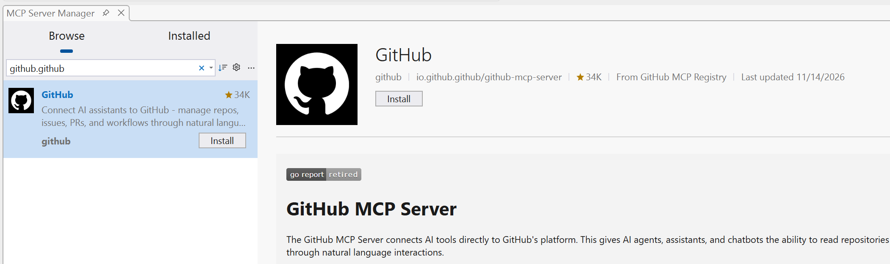
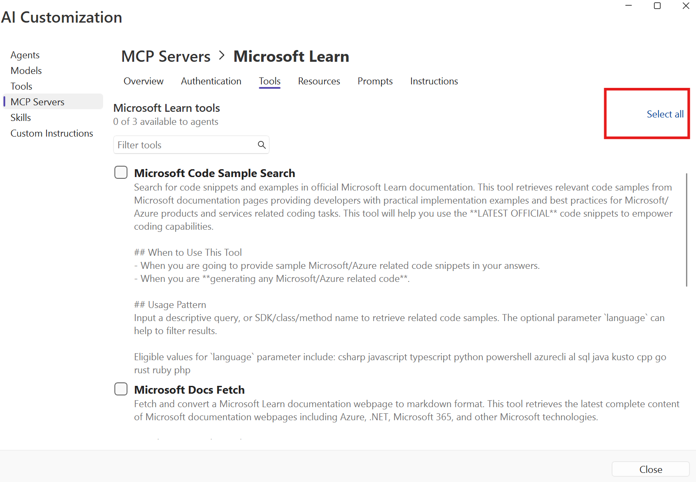
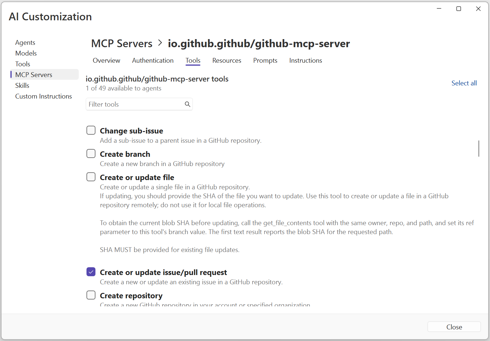

Model Context Protocol (MCP) is an open protocol that standardizes how applications provide context to large language models (LLMs). MCP servers extend GitHub Copilot's capabilities by connecting to external tools and services, giving it access to real-time data and the ability to perform actions.

In this part, you'll learn how to add MCP servers to Visual Studio and use them to get information about optimizing your application.

> [!NOTE]
> These steps use the MCP Server Manager and AI Customization window in Visual Studio 2026. See the [Visual Studio 2026 release notes](https://learn.microsoft.com/en-us/visualstudio/releases/2026/release-notes) for details about MCP server management and tool selection, including additional screenshots of the UI.

## Adding MCP Servers from the Gallery

Visual Studio provides a gallery of pre-configured MCP servers that you can easily add to your project.

To install the GitHub MCP server:
1. [ ] In Visual Studio, select **Extensions > MCP Registries...** to open the **MCP Server Manager**.

   

1. [ ] Select the **Browse** tab and search for `github.github`.

   > [!TIP]
   > Use `github.github` to target the GitHub MCP server's package identifier (`io.github.github/github-mcp-server`). Searching for just `GitHub` can return unrelated servers from the GitHub registry, making the server harder to find.

1. [ ] Select the **GitHub** server published by **github**, then click **Install**.

   

1. [ ] When prompted, trust and install the remote server.

   

To see your installed tools and authenticate the GitHub MCP server:
1. [ ] Open Copilot Chat from **View -> GitHub Copilot Chat**.
1. [ ] Click on the **Tools** icon at the bottom of the chat window to see built-in tools and tools from installed MCP servers.

   

1. [ ] The GitHub MCP requires authentication. In the **Tools** menu, open the options for the added GitHub MCP server and select **Edit**:

   

1. [ ] In the configuration file, select **Authentication Required**, then **Authenticate**, and complete the GitHub sign-in. Confirm that the server is online. If the authentication link is missing, enable CodeLens under **Tools -> Options -> Text Editor -> CodeLens**.

   

> [!TIP]
> MCP servers can provide access to documentation, APIs, and other services that can help Copilot give you more accurate and contextual responses.

## Using MCP Servers to Get Information

Use the Microsoft Learn MCP server to get current guidance about optimizing asset loading in the application.

1. [ ] In Copilot Chat, switch to **Agent** mode.
1. [ ] Open **AI Customization** and select **MCP Servers**. If Microsoft Learn is not listed, choose **Add custom MCP server** from the chat's **Tools** menu and add an HTTP server named `Microsoft Learn` with the URL `https://learn.microsoft.com/api/mcp`. See [Microsoft Learn MCP Server](https://learn.microsoft.com/en-us/training/support/mcp) and [Visual Studio MCP setup](https://learn.microsoft.com/en-us/visualstudio/ide/mcp-servers?view=visualstudio).
1. [ ] Select **Microsoft Learn** and open the **Tools** tab. Enable the documentation search and fetch tools.

   This example shows the tools tab; enable only the tools needed for the exercise:

   

1. [ ] Click **Close** to return to Copilot Chat.
1. [ ] Type the following prompt: `Using the Microsoft Learn docs mcp, what are the best practices for optimizing image loading and asset delivery in a Blazor Server application?`
1. Copilot will ask for permission for each request. You can approve each manually or **Allow in this session**
1. 
1. [ ] Review the response from Copilot, which now has access to the latest Microsoft documentation through the MCP server.

## Creating GitHub Issues with MCP

The GitHub MCP server allows Copilot to interact with your GitHub repository. Let's use it to create issues for improvements we want to make to the application.

> [!NOTE]
> This exercise requires write access to the repository. Fork `workshop-tinyshop` and point `origin` at your fork as described in setup. If your account cannot fork, skip issue creation and ask Copilot to draft the issues instead.

1. [ ] Open **AI Customization**, select **MCP Servers**, and select the GitHub MCP server (shown as **io.github.github/github-mcp-server**).
1. [ ] Open the **Tools** tab and enable **Create or update issue/pull request**. You can use **Filter tools** to find it instead of enabling every GitHub tool.

   

1. [ ] Click **Close** to return to Copilot Chat.
1. [ ] In the same chat session, ask: `Based on the asset optimization recommendations, create 3 GitHub issues for improving TinyShop performance in YOUR-USERNAME/workshop-tinyshop.` Replace `YOUR-USERNAME` with your GitHub username.

   > NOTE:
   > Copilot will use the GitHub MCP server to create the issues directly in your repository. You may be prompted to authorize the action.

1. [ ] Review the issues that Copilot proposes to create.
1. [ ] Check that the proposed target is your fork, then approve creation when prompted.
1. [ ] Navigate to your fork on GitHub to verify that the issues have been created.

**Key Takeaway**: MCP servers extend GitHub Copilot's capabilities by connecting it to external services and documentation. This allows Copilot to provide more accurate, up-to-date information and perform actions like creating GitHub issues directly from the chat interface.

## Check your understanding

Why can enabling fewer MCP toolsets improve both response quality and security?

Check your answer

Every enabled tool must be described in the model context, leaving less room for your code and conversation. A smaller toolset also makes it easier for Copilot to select the right capability and reduces the actions available if a prompt or server behaves unexpectedly. Enable the servers and tools relevant to the current task, then disable the rest.

**Go deeper:** [Understand MCP toolset selection](https://docs.github.com/en/copilot/concepts/context/mcp).

---

[Back: Part 07 - Commit Summary Descriptions](../part08-commit-summary-descriptions/) | [Next: Part 09 - Planning with /plan](../part10-planning-mode/)
